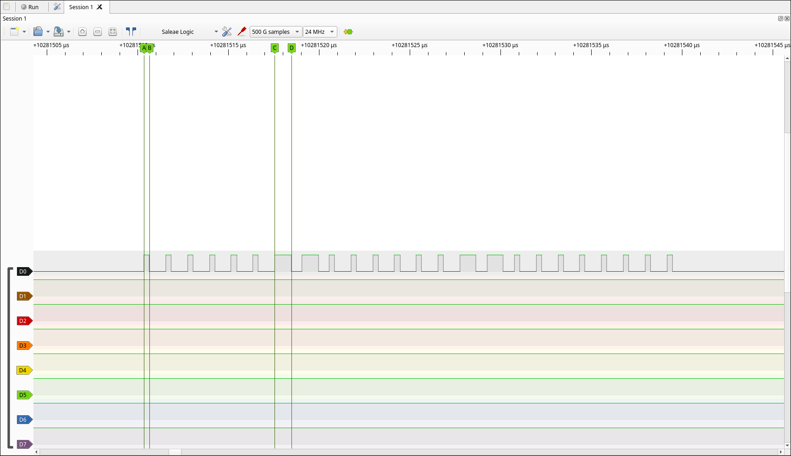

# ch03-blink - The on-board RGB LED: using a driver someone else wrote

Driving the DevKit's addressable RGB LED with the `led_strip` component and checking the signal with the logic
analyzer.

## Goal

Use a library through the ESP-IDF component manager, read its source to see how it works, and confirm its
output on the logic analyzer.

## Wiring

| From | To | Notes |
|------|----|-------|
| GPIO 38 | Logic analyzer D0 | On-board LED data line (DevKitC v1.1) |
| GND | Logic analyzer GND | Connect first |

## What I did

- Copied ESP-IDF's `blink` example, appended my module settings to its `sdkconfig.defaults`, and set the target
- In menuconfig, chose the LED strip LED type with the RMT backend, on GPIO 38
- The example pulls in the driver through `main/idf_component.yml` (`espressif/led_strip: "^3.0.0"`);
  version 3.1.0 got downloaded into `managed_components/`
- Changed the example to step through six low-brightness colours: red, yellow, green, cyan, blue, magenta
- Captured the LED data line in PulseView at 24 MHz

## Reading the driver

- The bit timings are declared in `led_strip_types.h` (`t0h_ns`, `t1h_ns`, `t0l_ns`, `t1l_ns`). The values
  for each LED model are in `led_strip_rmt_dev.c`. For the WS2812:
    - 0 bit: 300 ns high, 900 ns low
    - 1 bit: 900 ns high, 600 ns low
- `led_strip_set_pixel()` checks its arguments, then calls the strip's `set_pixel` function pointer. For the
  RMT backend this only writes the colour bytes into a buffer in RAM, in G, R, B order. All CPU.
- `led_strip_refresh()` checks its arguments, then calls the strip's `refresh` function pointer, which starts
  an RMT transmission and waits for it to finish. The encoder that turns each byte into pulse durations
  runs on the CPU. The RMT peripheral plays those pulses out on the pin with exact timing, in hardware.

## Results

- Short (0 bit) high pulse: 300 ns, long (1 bit) high pulse: 1000 ns. The driver uses 300 ns and 900 ns; at
  24 MHz one sample is ~42 ns, and the LED tolerates about +-150 ns.
- Decoded one update while the LED was yellow (`{3, 3, 0}`):
  `00000011 00000011 00000000` = 3, 3, 0
- Expected for magenta (`{3, 0, 3}`), not captured: `00000000 00000011 00000011` (G = 0, R = 3, B = 3)



## Build

```sh
idf.py set-target esp32s3
idf.py -p /dev/ttyACM0 build flash monitor
# Exit the monitor with Ctrl+]
```
